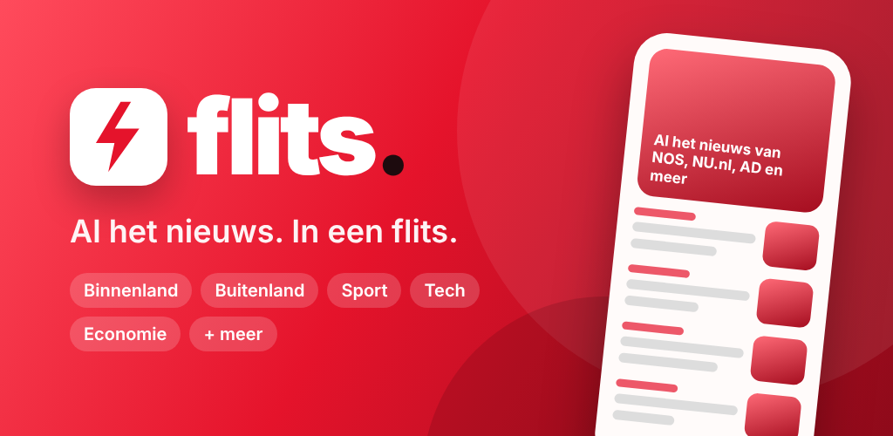
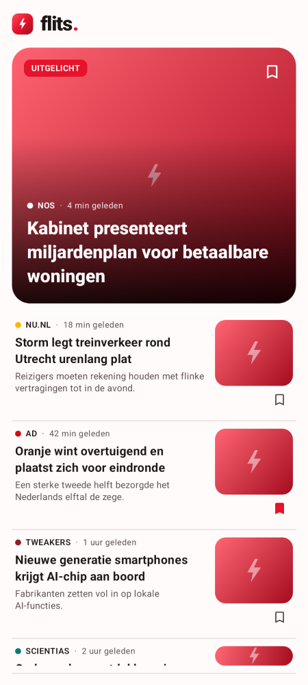
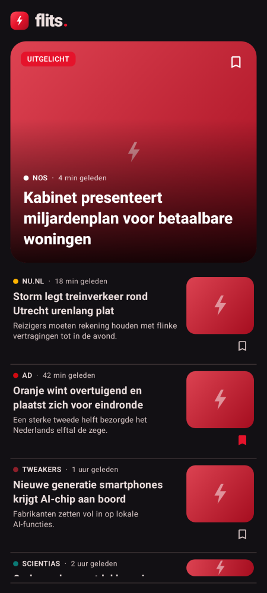

<p align="center"></p>

# Flits ⚡ – Al het nieuws. In een flits.

Een moderne Android-nieuwsapp (Kotlin + Jetpack Compose + Material 3) in rood thema die de RSS-feeds
van de grootste Nederlandse en internationale nieuwssites bundelt.

| Licht | Donker |
|---|---|
|  |  |

## Functies
- **14 rubrieken**: Voorpagina, Binnenland, Buitenland, Politiek, Economie, Sport, Voetbal, Tech, Wetenschap,
  Gezondheid, Entertainment, Cultuur & Media, Opmerkelijk en World (EN)
- **19 bronnen / 60+ feeds**: NOS, NU.nl, De Telegraaf, AD, de Volkskrant, NRC, Trouw, Het Parool, RTL Nieuws,
  Tweakers, Androidplanet, iCulture, Scientias, Voetbalzone, VRT NWS, BBC, The Guardian, Al Jazeera, The Verge
- Veegbare tabs, pull-to-refresh, uitgelicht artikel, skeleton-loading
- Zoeken over al het nieuws, artikelen bewaren (leeslijst)
- Bronnen en rubrieken aan/uit zetten, licht/donker/systeem-thema
- Artikelen openen in de app (Custom Tabs) of de browser, delen
- Adaptief icoon (incl. Android 13+ themed icon), splash screen, edge-to-edge
- Geen tracking, geen account, alleen HTTPS

Alle feeds staan in [`FeedCatalog`](app/src/main/java/nl/flits/nieuws/data/Feeds.kt) – een bron of feed toevoegen is één regel.
Een feed die niet laadt wordt overgeslagen en bovenaan de lijst gemeld; de rest van de rubriek blijft werken.

## Bouwen
Vereist JDK 17+ en de Android SDK (platform 36).

```bash
./gradlew assembleDebug          # debug-APK
./gradlew testDebugUnitTest      # unit tests (RSS-parser + feedcatalogus)
./gradlew recordPaparazziDebug   # screenshots opnieuw genereren
```

## Publiceren in de Play Store
1. **Upload-sleutel maken** (eenmalig, bewaar hem goed!):
   ```bash
   keytool -genkeypair -v -keystore flits-upload.jks -keyalg RSA -keysize 2048 -validity 10000 -alias flits
   ```
2. **`keystore.properties`** in de projectroot (staat in `.gitignore`):
   ```properties
   storeFile=flits-upload.jks
   storePassword=...
   keyAlias=flits
   keyPassword=...
   ```
3. **App-bundle bouwen**: `./gradlew bundleRelease` → `app/build/outputs/bundle/release/app-release.aab`
4. In de [Play Console](https://play.google.com/console): nieuwe app aanmaken, Play App Signing aanzetten,
   de AAB uploaden en de vermelding invullen met de teksten uit [`store/listing-nl.md`](store/listing-nl.md)
   en de graphics uit [`store/graphics/`](store/graphics).
5. **Privacybeleid**: zet GitHub Pages aan (Settings → Pages → branch `main`, map `/docs`), dan staat
   [`docs/privacy.html`](docs/privacy.html) op `https://robindrabbels.github.io/nieuwsapp/privacy.html`.
6. Verhoog bij elke update `versionCode` (en `versionName`) in `app/build.gradle.kts`.

**CI:** de GitHub Actions-workflow bouwt bij elke push een debug-APK en een release-AAB. Voeg de secrets
`KEYSTORE_BASE64` (`base64 -w0 flits-upload.jks`), `KEYSTORE_PASSWORD`, `KEY_ALIAS` en `KEY_PASSWORD` toe voor een
ondertekende AAB.

## Projectstructuur
```
app/src/main/java/nl/flits/nieuws/
├── data/      Feeds (bronnen + categorieën), RssParser, NewsRepository, SettingsRepository
├── ui/        NewsViewModel, navigatie (FlitsRoot), thema, componenten en schermen
└── util/      Tijdsweergave, links openen/delen
```

## Disclaimer
Flits toont titels, korte samenvattingen en afbeeldingen uit openbare RSS-feeds en linkt naar de oorspronkelijke artikelen.
Alle rechten op de inhoud liggen bij de uitgevers.
